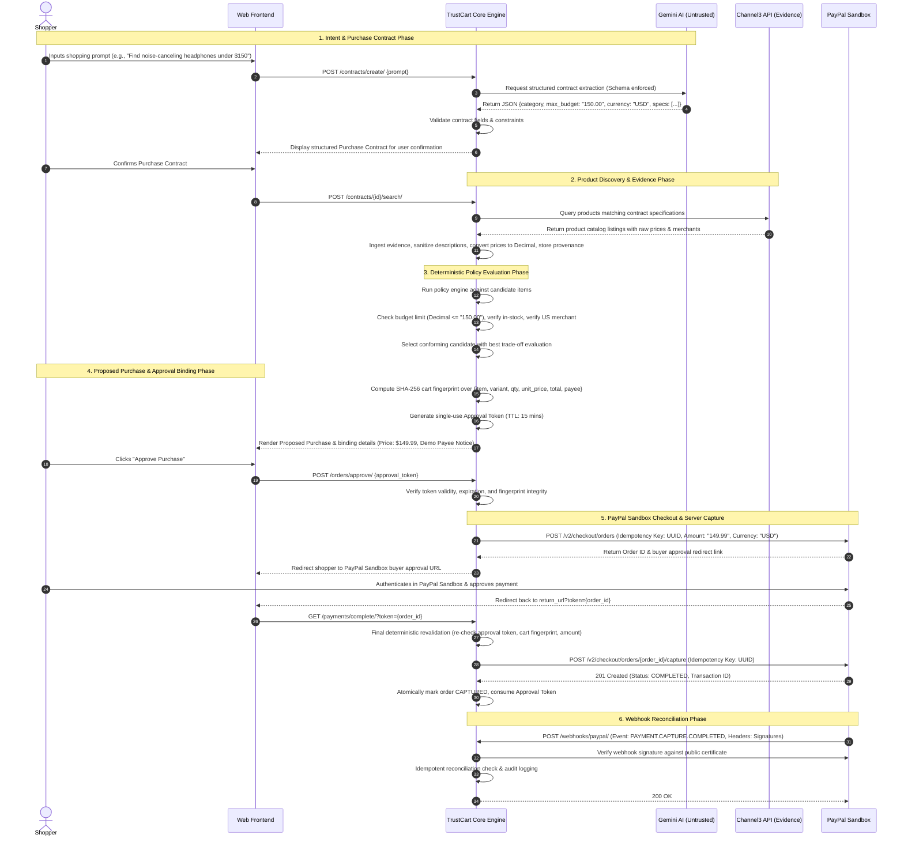

# TrustCart End-to-End Data Flow

This document details the lifecycle of a TrustCart shopping session, tracing data from the initial user requirement to final payment capture and reconciliation.

---

## Complete Transaction Lifecycle



---

## Data State Machine

An order traverses the following deterministic state transitions:

```
[ DRAFT ]
    │
    ▼ (User confirms Purchase Contract)
[ CONTRACT_CONFIRMED ]
    │
    ▼ (Channel3 search & deterministic policy pass)
[ PROPOSED ]
    │
    ▼ (Shopper explicitly approves proposal)
[ APPROVED ] (Approval Token generated; TTL 15 mins)
    │
    ├───(Token expires or details mutate)───► [ VOIDED / EXPIRED ]
    │
    ▼ (PayPal order created; buyer redirects)
[ PAYPAL_AUTHORIZED ]
    │
    ▼ (Server revalidation & successful capture)
[ CAPTURED ]
    │
    ▼ (Webhook verified)
[ RECONCILED ]
```

### Safety Rules Enforced Across Transitions:
1. Moving from `PROPOSED` to `APPROVED` requires an active, authenticated shopper session.
2. If any cart attribute (price, shipping, item variant) changes while in `APPROVED`, the status immediately transitions to `VOIDED`.
3. Capture can only be triggered from `PAYPAL_AUTHORIZED` and must result in atomic transition to `CAPTURED`. Duplicate capture attempts are prevented via idempotency keys and database-level row locking.

