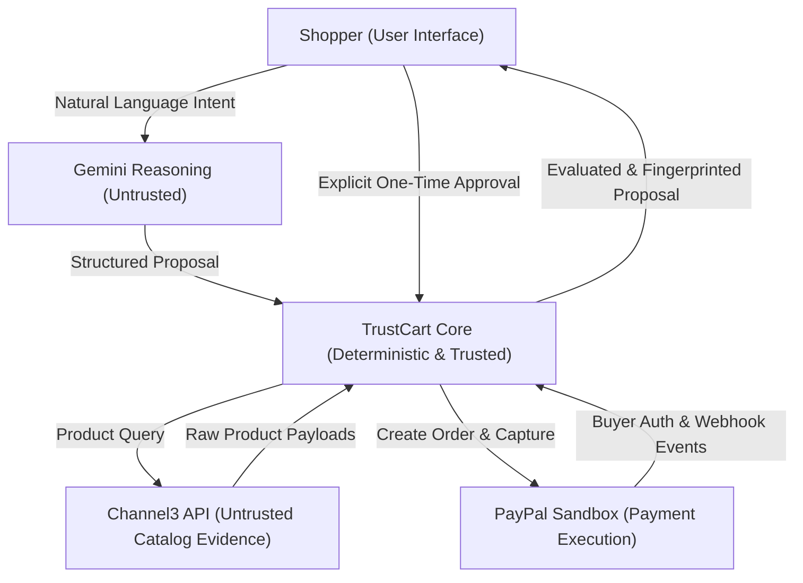

# TrustCart System Architecture Overview

## 1. Architectural Philosophy

TrustCart operates on a fundamental principle of **Separation of Reasoning from Execution Authority**. 

Large Language Models (LLMs) excel at natural language parsing, semantic comparison, and synthesizing complex information. However, they are fundamentally non-deterministic, susceptible to prompt injection, and vulnerable to hallucinations. Financial commitments and payments require deterministic state machines, exact decimal math, auditable business policies, and verifiable cryptographic boundaries.

---

## 2. Component Taxonomy & Responsibilities

### A. Gemini 2.5 (Advisory Reasoning Layer - Untrusted)
- **Role**: Natural language interpretation, extracting shopper constraints into structured parameters, synthesizing trade-offs between candidate products.
- **Constraints**: 
  - Strictly advisory.
  - Produces structured output conforming to strict JSON schemas.
  - Zero access to payment execution APIs, credentials, or state transitions.
  - Outputs are treated as unverified suggestions subject to deterministic backend validation.

### B. Channel3 API (Product Discovery & Market Evidence Layer - Untrusted Evidence)
- **Role**: Aggregates real-world product catalog data, live stock availability, pricing, merchant details, and variants across US merchants (USD).
- **Constraints**:
  - All returned payloads are treated as untrusted external evidence.
  - System enforces provenance tracking: recording retrieval timestamp, source seller, and exact variant identifier.
  - Data older than cache TTL is treated as stale. Missing, conflicting, or malformed data causes policy evaluation to fail closed.

### C. TrustCart Backend Engine (Deterministic Authority - Trusted Core)
- **Role**: Django-based application core governing contracts, policy verification, approval tokens, transaction states, and payment orchestration.
- **Key Subsystems**:
  - **Contract Engine**: Validates shopper parameters against allowed ranges and schemas.
  - **Policy Engine**: Deterministic Python rules verifying budget ceilings, merchant criteria, and variant compatibility.
  - **Approval Manager**: Computes cryptographic cart fingerprints (SHA-256), issues time-limited single-use approval tokens, and tracks lifecycle states.
  - **Payment Orchestrator**: Handles PayPal order creation with idempotency, verifies webhook signatures, and triggers server-side capture.
- **Precision Guarantee**: 100% `decimal.Decimal` monetary arithmetic. Zero float operations.

### D. User Approval Boundary (Human-in-the-Loop)
- **Role**: Explicit human authorization of the immutable proposed purchase.
- **Mechanics**:
  - Displays exact line items, unit price, quantity, tax/shipping estimates, total, and demo payee notice.
  - Issues a single-use approval token valid for 15 minutes.
  - Any alteration to cart items or pricing automatically revokes the approval token.

### E. PayPal Orders API (Payment Execution Layer - Sandbox)
- **Role**: Executes payment authorization and server-side capture in PayPal's Sandbox environment.
- **Mechanics**:
  - TrustCart approval and PayPal buyer checkout approval are distinct, sequential gates.
  - Order creation and capture use unique idempotency keys (`PayPal-Request-Id`).
  - Capture runs server-side only after deterministic revalidation of the approval token and cart fingerprint.
  - Webhook notifications are cryptographically validated against PayPal certificates before reconciling internal order state.
  - Settles against a controlled, disclosed demo merchant/payee.

