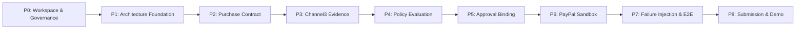

# TrustCart Implementation Roadmap

This roadmap outlines the planned execution sequence across all development phases. Each phase is bound to its strict acceptance criteria defined in [`TASK_GATES.md`](file:///d:/TrustCart/TASK_GATES.md).

---

## Roadmap Overview

---

## Detailed Phase Milestones

### Phase P0: Workspace & Governance Initialization
- **Target**: Day 1
- **Focus**: Environment verification, repository hygiene, security rules, workflow definitions, architecture docs, ADRs, zero-spend policy, and task gates.
- **Milestones**:
  - [x] Workspace inspected and verified.
  - [x] Git repository initialized.
  - [x] Security-hardened `.gitignore` and `.env.example` created.
  - [x] Antigravity rules (`00`, `10`, `20`, `30`, `40`) created.
  - [x] Workflows and skills created.
  - [x] Architecture, decisions (`ADR-0001` through `ADR-0004`), threat model, and test strategy documents written.
  - [x] Zero-spend engineering policy and free-tier service registry documented.
  - [x] Account dashboard evidence verified for free tiers (Channel3 1,000 credits/mo + 1,000 bonus credits, Gemini Free Tier with Flash Lite/Flash quotas, Context7 1,000 requests/mo, PayPal Sandbox).
  - [ ] User review and formal sign-off.

### Phase P1: Architecture & Application Foundation
- **Target**: Day 2
- **Focus**: Django 6.1 dependency installation, dependency cost-impact review, core project configuration, SQLite setup, health check endpoint, base template styling.
- **Milestones**:
  - [ ] Perform dependency cost-impact review (verifying 100% permissive open-source licenses, zero paid SDKs).
  - [ ] Install and verify Django 6.1, Ruff, and test packages in `.venv`.
  - [ ] Scaffold `trustcart` Django project and core apps.
  - [ ] Configure local SQLite database (zero cloud DB cost).
  - [ ] Implement base HTML layout and static asset configuration.
  - [ ] Implement and verify `/health/` monitoring endpoint.
  - [ ] Verify zero cloud expenditure incurred.

### Phase P2: Purchase Contract Creation & Confirmation
- **Target**: Day 3
- **Focus**: Gemini structured output integration for parsing shopper intent into immutable Purchase Contracts within verified Free Tier quotas.
- **Milestones**:
  - [ ] Verify active Gemini API key against Free Tier project (zero billing attached; map dashboard names to API model identifiers).
  - [ ] Configure model routing: Flash Lite for routine shopping tasks; Gemini 3.8 Flash for complex multi-product reasoning.
  - [ ] Define `PurchaseContract` schema and data models.
  - [ ] Implement Gemini API client with strict JSON schema parsing on Free Tier models.
  - [ ] Implement quota exhaustion detection and safe fallback to labeled demo fixtures.
  - [ ] Build user contract review and confirmation UI.
  - [ ] Add negative tests for prompt injection and malformed model outputs.
  - [ ] Verify zero API cost incurred.

### Phase P3: Channel3 Product Search & Evidence Provenance
- **Target**: Day 4
- **Focus**: Live product data retrieval via Channel3 API, provenance logging, Decimal price conversion, and 1,000 credit/month usage budget governance with separate bonus balance tracking.
- **Milestones**:
  - [ ] Verify Channel3 free allowance (1,000 credits/mo resetting 1st of month + 1,000 bonus credits).
  - [ ] Configure separate tracking for monthly allowance and one-time bonus credits (bonus consumed only after monthly credits).
  - [ ] Implement product caching by ID to prevent duplicate external requests.
  - [ ] Implement `Channel3Client` with retry logic, rate limit awareness, and quota-exhaustion fallback.
  - [ ] Build product evidence models with timestamp and variant tracking.
  - [ ] Implement fail-closed handling for missing prices, stock, or non-USD currencies.
  - [ ] Record offline mock fixtures for test repeatability without burning credits.
  - [ ] Verify zero credit spend beyond free tier.

### Phase P4: Deterministic Policy & Trust Evaluation
- **Target**: Day 5
- **Focus**: Deterministic Python rule engine evaluating products against user contracts with zero external API costs.
- **Milestones**:
  - [ ] Implement budget ceiling, shipping, and specification validation rules entirely in local Python.
  - [ ] Implement explainable evaluation report generator.
  - [ ] Write unit tests verifying zero float math and fail-closed behavior on discrepancies.
  - [ ] Verify zero external compute or service costs.

### Phase P5: Exact, Immutable, One-Use Purchase Approval
- **Target**: Day 6
- **Focus**: Cryptographic cart fingerprinting, proposal presentation, and single-use approval token lifecycle via local cryptographic primitives.
- **Milestones**:
  - [ ] Implement SHA-256 cart fingerprinting generator.
  - [ ] Build approval token lifecycle manager (15-min TTL, atomic single-use consumption).
  - [ ] Create user proposal presentation UI with explicit binding confirmation.
  - [ ] Add tamper tests, replay tests, and concurrency tests.
  - [ ] Verify zero licensing or external validation fees.

### Phase P6: PayPal Sandbox Order, Approval, Capture & Reconciliation
- **Target**: Day 7
- **Focus**: Server-side PayPal Orders API integration strictly in Sandbox environment with mock accounts, buyer approval redirect, capture, and signed webhook reconciliation.
- **Milestones**:
  - [ ] Verify PayPal integration uses exclusively Sandbox endpoints (`api-m.sandbox.paypal.com`) and mock credentials.
  - [ ] Implement `PayPalClient` supporting Orders v2 API with `PayPal-Request-Id` idempotency.
  - [ ] Implement buyer redirect and return URL handling in Sandbox.
  - [ ] Implement server-side capture service with pre-capture revalidation.
  - [ ] Implement webhook listener with cryptographic signature verification.
  - [ ] Clearly disclose demo merchant/payee in the UI.
  - [ ] Verify zero live transactions, zero real money moved, and zero payment processing fees.

### Phase P7: Security, Failure Injection & End-to-End Testing
- **Target**: Day 8
- **Focus**: Adversarial testing, failure injection, race condition validation, quota exhaustion simulation, and comprehensive regression verification using mock fixtures.
- **Milestones**:
  - [ ] Run full test suite covering positive and negative paths using offline fixtures to preserve live quotas.
  - [ ] Execute failure injection tests (price shifts, expired tokens, duplicate captures).
  - [ ] Execute quota exhaustion test cases asserting fail-safe labeled fixture fallback.
  - [ ] Audit implementation against `THREAT_MODEL.md`.
  - [ ] Verify zero paid API calls or cloud resource charges during test runs.

### Phase P8: Deployment, Documentation & Hackathon Submission
- **Target**: Day 9
- **Focus**: Final packaging, presentation assets, demo video recording walk-through, and submission using zero-spend platforms.
- **Milestones**:
  - [ ] Prepare clean demo walkthrough script runnable entirely on localhost.
  - [ ] Verify fresh clone reproducibility on clean Windows environment.
  - [ ] Verify free-tier submission hosting (public GitHub repo, free YouTube video).
  - [ ] Perform final audit confirming total project financial expenditure is strictly $0.00.
  - [ ] Finalize submission documentation.

